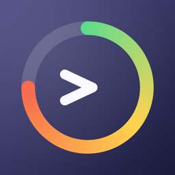
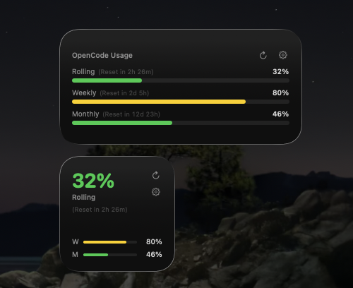
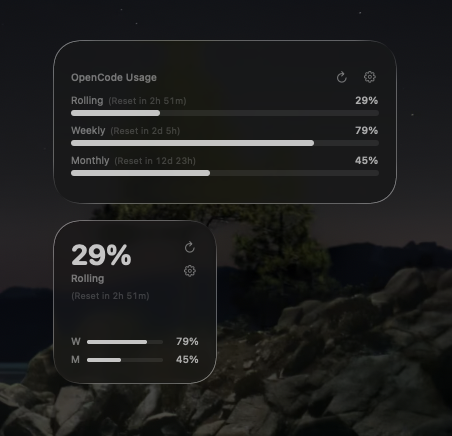

# OpenCode Usage Monitor

[](https://github.com/wiscaksono/opencode-usage/actions/workflows/ci.yml)

<p align="center">
  
</p>

A native macOS Menu Bar application built with SwiftUI to easily monitor your Opencode Go subscription usage (Rolling, Weekly, and Monthly limits).


## Features

- **Real-Time Monitoring**: View your Rolling, Weekly, and Monthly usage directly from the menu bar.
- **Smart Progress Bars**: Progress bar colors dynamically change based on usage levels (Green for safe, Yellow for medium, Red for critical).
- **Auto-Refresh**: Automatically fetches new data every 5 minutes, or you can manually refresh.
- **Lightweight**: Runs as a background agent (`LSUIElement`) with no dock icon clutter.
- **Desktop Widget**: A WidgetKit widget (small + medium) for the desktop and Notification Center.
- **Terminal-Driven**: No Xcode GUI required. Built with plain SwiftPM and a `Makefile`.

## Prerequisites

- macOS 26+ with Command Line Tools / Xcode installed.

## Installation & Setup

1. **Clone the repository** (or navigate to the project directory):
   ```bash
   cd opencode-usage
   ```

2. **Build**:
   ```bash
   make build
   ```

3. **Run the app**:
   ```bash
   make run
   ```
   *(Note: The app will appear in your macOS Menu Bar. It does not have a dock icon).*

## Configuration: How to Get Your API Key

The app uses the official OpenCode API (`https://opencode.ai/zen/go/v1/usage`) to fetch your usage. You only need your OpenCode API key.

1. Open your opencode console.
2. Go to **Settings** → **API Keys**.
3. Copy your API key (starts with `sk-...`).
4. Open the **OpenCode Usage Monitor** from your Mac menu bar.
5. Click the **Settings (⚙️)** icon in the top right corner of the header.
6. Paste your API key into the text field and click **Save**.

The app will automatically fetch your usage every 5 minutes.

## Desktop Widget

The app includes a WidgetKit widget (small and medium sizes) that can be placed on the macOS desktop or in Notification Center.

| Light | Dark |
| :---: | :---: |
|  |  |

1. Run the app once (`make run`) so the widget extension gets registered with the system.
2. Open **Notification Center** → click **+** (or right-click the desktop → **Edit Widgets**).
3. Search for **"OpenCode Usage"** and drag the widget to the desktop or Notification Center.

Notes:

- The widget never sees your API key — the key stays in the Keychain. The app publishes non-secret usage snapshots (percentages and reset times) that the widget reads, and the widget's refresh button asks the running app to refetch. Keep the menu bar app running for live data.
- Refresh timing is managed by macOS: the widget requests a new timeline every 5 minutes, but the system may throttle refreshes under memory or resource pressure.

## Development Commands

A `Makefile` is provided for easy terminal workflows:

- `make build`: Builds the application and assembles the app bundle (Debug configuration).
- `make run`: Kills any existing instance, builds, and runs the app.
- `make clean`: Removes the `.build/` and `build/` directories.
- `make test`: Runs the unit test suite ([Swift Testing](https://developer.apple.com/xcode/swift-testing/)).
- `make format`: Formats the codebase with [SwiftFormat](https://github.com/nicklockwood/SwiftFormat).
- `make logs`: Streams the unified logs specifically for this app subsystem (`com.wiscaksono.opencode-usage`).

## Releases

Pre-built `.dmg` images are published automatically on every version tag — grab the latest one from [Releases](https://github.com/wiscaksono/opencode-usage/releases).

> The app is ad-hoc signed, so macOS Gatekeeper may warn on first launch. Right-click the app → **Open** once to allow it.

## License

MIT License
